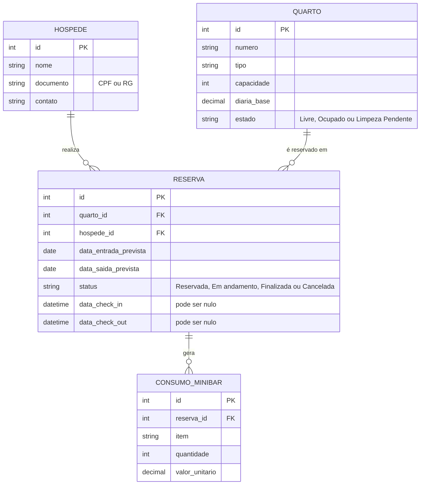

# DER — Diagrama Entidade-Relacionamento

**Projeto:** Gestão de Hospedagem de Pequenos Hotéis/Pousadas
**Grupo:** CHECKFLOW
**Disciplina:** Manutenção e Melhoria de Software — Prof. Rogério Elias da Cunha

Este documento apresenta o modelo de dados do sistema, derivado do [`MODELO-DOMINIO.md`](MODELO-DOMINIO.md) e dos requisitos em [`REQUISITOS.md`](REQUISITOS.md). O banco de dados utilizado é o SQLite (`backend/pousada.db`).

## 1. Diagrama

Versão em imagem (caso o visualizador não renderize o Mermaid):

## 2. Entidades e atributos

### QUARTO

| Atributo    | Tipo    | Chave | Descrição                                                              |
| ----------- | ------- | ----- | ---------------------------------------------------------------------- |
| id          | inteiro | PK    | Identificador único do quarto.                                         |
| numero      | texto   |       | Número/identificação do quarto (RF01).                                 |
| tipo        | texto   |       | Tipo do quarto.                                                        |
| capacidade  | inteiro |       | Quantidade de hóspedes que o quarto comporta.                          |
| diaria_base | decimal |       | Valor base da diária.                                                  |
| estado      | texto   |       | Estado atual: `Livre`, `Ocupado` ou `Limpeza Pendente` (RF03, RNF01). |

### HOSPEDE

| Atributo  | Tipo    | Chave | Descrição                                                          |
| --------- | ------- | ----- | ------------------------------------------------------------------ |
| id        | inteiro | PK    | Identificador único do hóspede.                                    |
| nome      | texto   |       | Nome do hóspede.                                                   |
| documento | texto   |       | Documento do hóspede (CPF ou RG), validado no cadastro (RF18).     |
| contato   | texto   |       | Informação de contato do hóspede.                                  |

### RESERVA

Representa tanto a reserva quanto a estadia (a mesma entidade acompanha o ciclo completo).

| Atributo              | Tipo     | Chave | Descrição                                                                         |
| --------------------- | -------- | ----- | --------------------------------------------------------------------------------- |
| id                    | inteiro  | PK    | Identificador único da reserva.                                                   |
| quarto_id             | inteiro  | FK    | Quarto reservado (referencia `QUARTO.id`).                                        |
| hospede_id            | inteiro  | FK    | Hóspede titular (referencia `HOSPEDE.id`).                                        |
| data_entrada_prevista | data     |       | Data prevista de entrada (check-in).                                              |
| data_saida_prevista   | data     |       | Data prevista de saída (check-out).                                               |
| status                | texto    |       | `Reservada`, `Em andamento`, `Finalizada` ou `Cancelada`.                         |
| data_check_in         | data/hora|       | Momento em que o check-in foi realizado. Nulo até o check-in acontecer.           |
| data_check_out        | data/hora|       | Momento em que o check-out foi realizado. Nulo até o check-out acontecer.         |

### CONSUMO_MINIBAR *(escopo N2/N3 — RF11 e RF12)*

| Atributo       | Tipo    | Chave | Descrição                                             |
| -------------- | ------- | ----- | ----------------------------------------------------- |
| id             | inteiro | PK    | Identificador único do lançamento de consumo.         |
| reserva_id     | inteiro | FK    | Estadia à qual o consumo pertence (`RESERVA.id`).     |
| item           | texto   |       | Item consumido do minibar.                            |
| quantidade     | inteiro |       | Quantidade consumida.                                 |
| valor_unitario | decimal |       | Valor unitário do item no momento do lançamento.      |

## 3. Relacionamentos

| Relacionamento              | Cardinalidade | Descrição                                                                                       |
| --------------------------- | ------------- | ----------------------------------------------------------------------------------------------- |
| HOSPEDE → RESERVA           | 1 : N         | Um hóspede pode ter várias reservas; cada reserva pertence a um único hóspede.                  |
| QUARTO → RESERVA            | 1 : N         | Um quarto pode ter várias reservas ao longo do tempo; cada reserva é de um único quarto.        |
| RESERVA → CONSUMO_MINIBAR   | 1 : N         | Uma estadia pode ter vários lançamentos de consumo; cada lançamento pertence a uma única estadia. |

## 4. Regras do negócio que afetam o modelo

- **Estado do quarto:** o atributo `QUARTO.estado` só pode assumir `Livre`, `Ocupado` e `Limpeza Pendente`, e as transições seguem a máquina de estados do [`MODELO-DOMINIO.md`](MODELO-DOMINIO.md) (RNF01).
- **Conflito de período (RF05):** um mesmo `quarto_id` não pode ter duas reservas ativas com períodos sobrepostos.
- **Coerência de datas:** `data_saida_prevista` deve ser posterior a `data_entrada_prevista`.
- **Check-in e check-out (RN01, RN02, RN04):** `data_check_in` e `data_check_out` são preenchidas somente quando as operações ocorrem, o que explica serem opcionais.
- **Consumo de minibar (RN05):** só pode ser lançado em reservas com status `Em andamento`.

## 5. Observações

- O modelo foi construído a partir da documentação do projeto (`MODELO-DOMINIO.md` e `REQUISITOS.md`). Nomes e tipos das colunas devem ser conferidos com o esquema real do banco (`backend/pousada.db`) e ajustados aqui caso haja divergência.
- A issue de validação de CPF/RG (RF18) pode exigir um atributo adicional em `HOSPEDE` (por exemplo, `tipo_documento`) caso o usuário precise escolher entre CPF e RG. Essa decisão depende da implementação e, se adotada, o DER deve ser atualizado.
